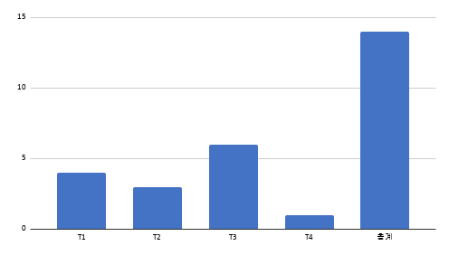
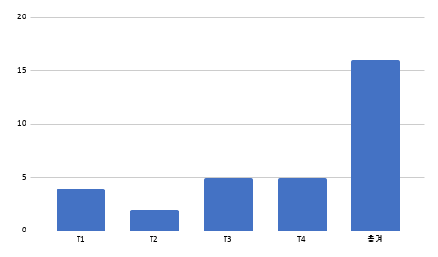
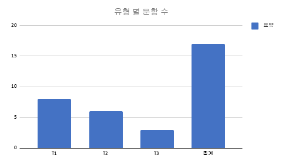
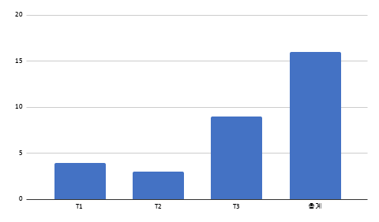
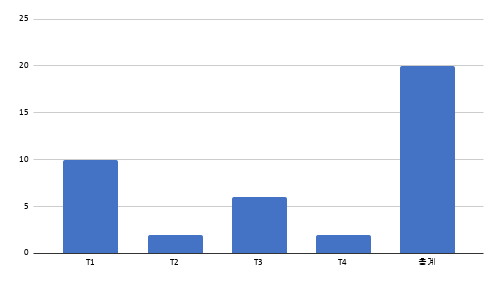
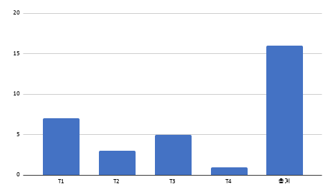
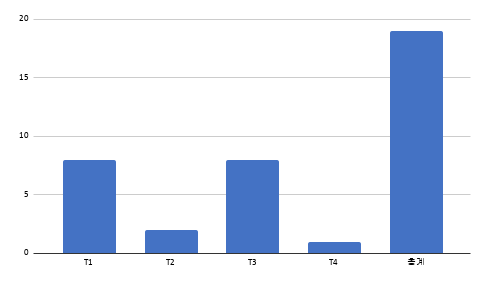

# 문항 유형 분류 (Magnet Virtual Summit 2025 & 2026)

총 118개 문항을 증거 유형(T1~T4)별로 분류한 결과 및 이미지별 분포 차트입니다.

## 1. 전체 요약

* **상세 데이터:** [문항 유형 분류 - 전체 요약.csv](./data/문항%20유형%20분류%20-%20전체%20요약.csv)

| 코드 | 유형 | 주요 증거 |
| :--- | :--- | :--- |
| **T1** | 시스템·파일 분석 | 파일 시스템, 레지스트리, 계정, 설치 정보, OS 설정 |
| **T2** | 사용자·기기 활동 분석 | 로그인, 위치, 통화, 기기 연결, 실행 기록, 네트워크 |
| **T3** | 애플리케이션 데이터 분석 | 브라우저, 메신저, 이메일, SNS, 앱 내부 DB |
| **T4** | 복합 증거 분석 | 서로 다른 아티팩트의 정보를 결합해야 해결 가능 |

---

## 2. 이미지별 문항 유형 분포

### Magnet Virtual Summit 2026
* **26 Android** ([CSV 보기](./data/문항%20유형%20분류%20-%2026Android.csv))  
  

* **26 iOS** ([CSV 보기](./data/문항%20유형%20분류%20-%2026iOS.csv))  
  

* **26 macOS** ([CSV 보기](./data/문항%20유형%20분류%20-%2026macOS.csv))  
  

---

### Magnet Virtual Summit 2025
* **25 Android** ([CSV 보기](./data/문항%20유형%20분류%20-%2025Android.csv))  
  

* **25 iOS** ([CSV 보기](./data/문항%20유형%20분류%20-%2025iOS.csv))  
  

* **25 Chromebook** ([CSV 보기](./data/문항%20유형%20분류%20-%2025Chromebook.csv))  
  

* **25 Windows** ([CSV 보기](./data/문항%20유형%20분류%20-%2025Windows.csv))  
  
